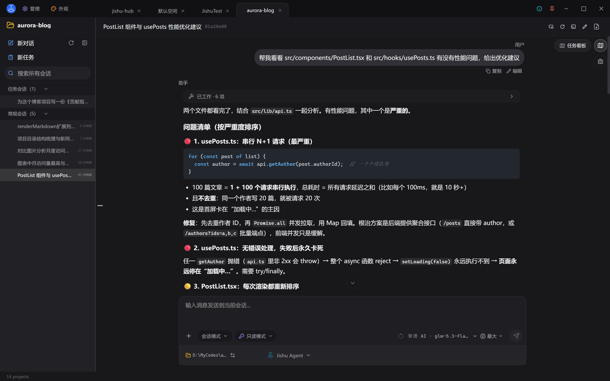

<div align="center">

# Jishu Hub（机枢）

### A Multi-Agent Collaboration Platform for CLI-based AI Agents

[](https://github.com/wang5766171/jishu-hub/releases)
[](https://github.com/wang5766171/jishu-hub/releases)
[](https://github.com/wang5766171/jishu-hub/releases/latest)
[](https://tauri.app/)

[English](#) | [中文](README_ZH.md)

Mirror: [Gitee](https://gitee.com/wangzwa/jishu-hub)

</div>

## Why Jishu Hub?

AI coding agents are evolving rapidly — Claude Code, OpenAI Codex, Open Code, and more are emerging as powerful CLI tools. But managing them is fragmented: scattered terminals, buried session logs, hand-edited configs.

**Jishu Hub (机枢)** is a multi-agent collaboration platform built on three pillars:

> - **One unified surface for many agents** — Claude Code, OpenAI Codex, Open Code, and the built-in Jishu Self agent chat, switch, and run in parallel in one desktop interface; multi-task across projects without context interference
> - **Local-first** — your data stays yours: session history lives alongside each project, Hub metadata in local `~/.jishu-hub/`, nothing is ever uploaded; native CLI passthrough with zero proxies, and a Tauri v2 + Rust build that stays small and starts instantly
> - **Craftable plugins** — a three-source plugin market (curated / Pi extension ecosystem / skill market) with one-click scene bundles and post-install guidance; the interface itself is reshaped by plugins (mounts, block renderers, themes) — you can even have an AI agent write an adapter plugin for you

## Quick Start

Download the latest release from [GitHub Releases](https://github.com/wang5766171/jishu-hub/releases/latest).

For users in China, downloads are also available from [Gitee Releases](https://gitee.com/wangzwa/jishu-hub/releases).

**System Requirements**: Windows 10 or later

## Screenshots

### Main Chat Interface
<p align="center">
  
</p>
A clean, focused, and immersive chat interface natively on your desktop. Jishu Hub replaces scattered terminal windows with a beautifully designed dark-mode workspace.

### Multimodal Capabilities
<p align="center">
  
  
</p>
Engage in rich multimodal conversations. Send images and files effortlessly, and use built-in image annotation tools to highlight exactly what you need the AI to focus on.

### Multi-Agent Collaboration & Parallel Tasks
<p align="center">
  
  
</p>
Switch smoothly between CLI agents (Claude Code, OpenAI Codex, Open Code, and more) via the plugin architecture. Run multiple sessions in parallel across projects without context interference.

### Project & Session Management
<p align="center">
  
  
</p>
Projects are automatically discovered and organized. Instantly locate past conversations with the powerful global session search.

### Configuration Editor
<p align="center">
  
</p>
Ditch manual JSON edits. Use the visual form-based editor to manage models, environment variables, and agent presets — with built-in templates for popular providers and automatic backup & restore.

## Features

### Plugin Market & Scene Guidance (v0.9.7+)
- Three-source plugin market: curated picks / Pi extension ecosystem (Pi Index) / skill market (SkillHub)
- One-click scene bundles: pick a scene (coding, office, video, …), fine-tune the checklist, install in one go
- Post-install guide card: what you installed, whether config is needed, how to use it first — plus one-click GUI adaptation to generate a UI plugin for an extension
- Empty-session scene suggestions: recommended tools per scene, injected with one click
- Cross-process plugin state sync: change state via CLI, sync in the GUI with one click

### Task Mode & Artifacts Center (v0.9.6+)
- Multi-step task orchestration: task graph, task & result cards, parallel processing
- Artifacts sidebar: session outputs at a glance, type-routed preview, direct artifact references
- Edit & resend: rewrite a past message and resend; unsent messages dismissible
- Agent pre-connect pool: answers from the first keystroke, no cold-start wait

### Multi-Agent Platform
- Plugin-based agent registration and one-click switching
- Currently supports **Claude Code**, **OpenAI Codex**, **Open Code**, **Jishu Self**
- AgentPlugin trait abstraction — ready to onboard the next agent
- Built-in environment detection and one-click agent installation (npm / winget / choco)

### CLI & Orchestration (v0.6.0)
- `jishu` CLI binary with 15 subcommands for agents, projects, sessions, config, and more
- Orchestrator engine with planner/dispatcher architecture for multi-step task execution
- LLM provider abstraction (OpenAI / Anthropic) with streaming support
- ACP (Agent Communication Protocol) server over stdio JSON-RPC
- Daemon mode for background task orchestration
- Evolution proposals for self-improving workflows

### In-App Chat
- Talk to AI agents directly inside Hub, no terminal required
- Send any file type as attachments (images, documents, code, etc.)
- Project-local files detected automatically — referenced by path, not copied
- Three ways to add files: paste, drag-and-drop, or file picker
- Streaming output with real-time Markdown rendering
- Floating window (picture-in-picture) for independent session viewing

### Session Management
- Browse all sessions grouped by project
- Full-text content search across sessions — instantly locate any conversation
- Custom session naming for easy identification
- Resume sessions in terminal with one click

### Project Management
- Auto-discovers all projects across agents
- Shows session count and last active time
- Add projects via folder picker (including uninitialized projects)

### Configuration
- Visual form editor for agent settings
- Model selector, environment variables, plugin toggles
- Built-in templates for popular providers (OpenRouter, SiliconFlow, etc.)
- Save and switch between config presets
- Auto-backup with one-click restore

### Custom Commands
- Create and manage custom slash commands
- Execute commands directly from the UI

### Personalization
- Three themes: Light / Colorful / Dark (dark by default)
- Independent font size control for UI and chat content (4 presets)
- Bilingual support (Chinese & English), auto-detects system language

## Roadmap

See [ROADMAP.md](./ROADMAP.md) for direction and cadence (Now / Next / Later).

## Join the Beta

- After trying it out, share feedback via [Gitee Issues](https://gitee.com/wangzwa/jishu-hub/issues) / [GitHub Issues](https://github.com/wang5766171/jishu-hub/issues) — feature ideas, UX problems, and compatibility reports are all welcome
- Check the pinned "Feature Roadmap" and "Feedback" issues for ongoing discussions

## Contributing

Contributions are welcome! Whether it's code, bug reports, or feature suggestions.

1. Fork the repository
2. Create your feature branch (`git checkout -b feature/amazing-feature`)
3. Commit your changes (`git commit -m 'Add amazing feature'`)
4. Push to the branch (`git push origin feature/amazing-feature`)
5. Open a Pull Request

<details>
<summary><strong>Local Development</strong></summary>

### Prerequisites

| Tool | Min Version | Purpose |
|------|-------------|---------|
| [Node.js](https://nodejs.org/) | 18+ | Frontend build |
| [Rust](https://rustup.rs/) | 1.77+ | Backend compile |
| [VS Build Tools 2022](https://visualstudio.microsoft.com/visual-cpp-build-tools/) | Latest | Windows C++ toolchain |

### Build & Run

```bash
git clone https://github.com/wang5766171/jishu-hub.git
cd jishu-hub
npm install
npm run tauri dev
```

</details>

<details>
<summary><strong>Tech Stack</strong></summary>

| Layer | Technology |
|-------|-----------|
| Desktop Framework | [Tauri v2](https://v2.tauri.app/) |
| Frontend | [React 19](https://react.dev/) + [TypeScript](https://www.typescriptlang.org/) |
| UI | [shadcn/ui](https://ui.shadcn.com/) + [Tailwind CSS v4](https://tailwindcss.com/) |
| Backend | [Rust](https://www.rust-lang.org/) |
| i18n | [i18next](https://www.i18next.com/) |

</details>

<details>
<summary><strong>Data Locations</strong></summary>

| Path | Description |
|------|-------------|
| `~/.jishu-hub/` | Hub metadata (agents, session names, presets, state, models) |
| `~/.jishu-hub/models.json` | LLM model presets configuration |
| `~/.jishu-hub/runs/` | Orchestrator run traces (JSONL) |
| `~/.claude/` | Claude Code agent data |
| `~/.codex/` | Codex agent data |

</details>

## License

[MIT](LICENSE) © 2025 Jishu Hub
