<div align="center">

# Jishu Hub（机枢）

### A Multi-Agent Collaboration Platform for CLI-based AI Agents

[](https://github.com/wang5766171/jishu-hub/releases)
[](https://github.com/wang5766171/jishu-hub/releases)
[](https://github.com/wang5766171/jishu-hub/releases/latest)
[](https://tauri.app/)

[English](#) | [中文](README_ZH.md)

Mirror: [Gitee](https://gitee.com/wangzwa/jishu-hub)

</div>

## Why Jishu Hub?

AI coding agents are evolving rapidly — Claude Code, OpenAI Codex, Open Code, and more are emerging as powerful CLI tools. But managing them is fragmented: scattered terminals, buried session logs, hand-edited configs.

**Jishu Hub (机枢)** is a multi-agent collaboration platform built on three pillars:

> - **One unified surface for many agents** — Claude Code, OpenAI Codex, Open Code, and the built-in Jishu Self agent chat, switch, and run in parallel in one desktop interface; multi-task across projects without context interference
> - **Local-first** — your data stays yours: session history is kept per project in each agent's own local directory (`~/.claude/`, `~/.codex/`, `~/.jishu-agent/`), Hub metadata in local `~/.jishu-hub/`, nothing is ever uploaded; native CLI passthrough with zero proxies, and a Tauri v2 + Rust build that stays small and starts instantly
> - **Craftable plugins** — a three-source plugin market (curated / Pi extension ecosystem / skill market) with one-click scene bundles and post-install guidance; the interface itself is reshaped by plugins (mounts, block renderers, themes) — you can even have an AI agent write an adapter plugin for you

## Quick Start

Download the latest release from [GitHub Releases](https://github.com/wang5766171/jishu-hub/releases/latest).

For users in China, downloads are also available from [Gitee Releases](https://gitee.com/wangzwa/jishu-hub/releases).

**System Requirements**: Windows 10 or later

**First launch**: the app checks the agent engine and your runtime (Node.js, Git, …) automatically, and walks you through installing anything that's missing.

<p align="center">
  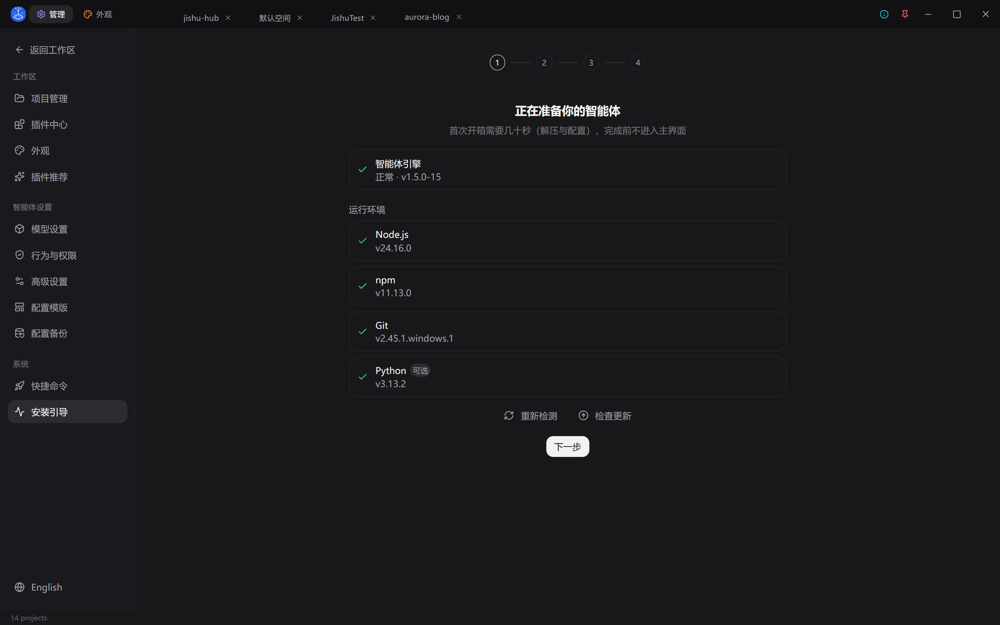
</p>

## Screenshots

### Main Chat Interface
<p align="center">
  
</p>
A clean, focused, and immersive chat interface natively on your desktop. Jishu Hub replaces scattered terminal windows with a beautifully designed dark-mode workspace.

### Multimodal Capabilities
<p align="center">
  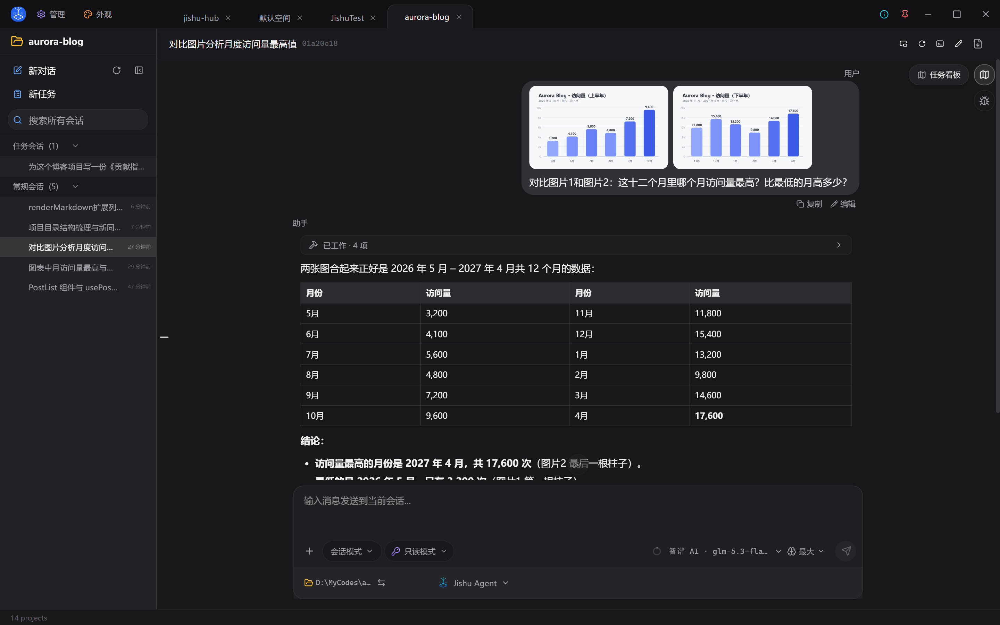
  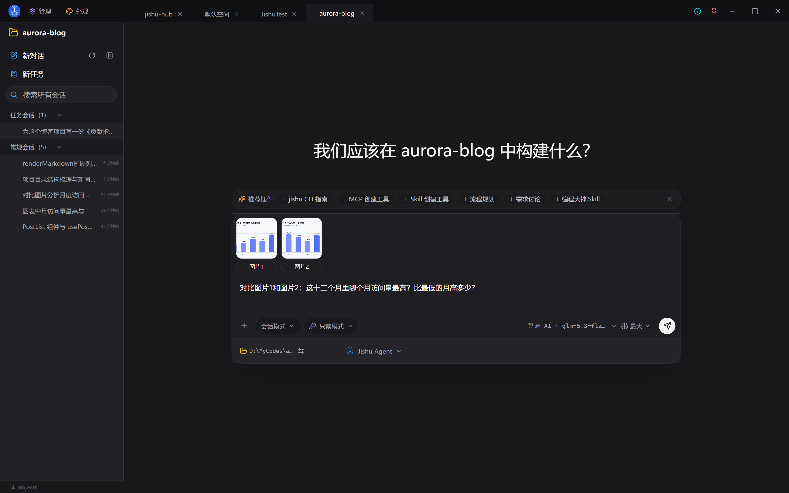
</p>
Engage in rich multimodal conversations. Send images and files effortlessly; multiple attachments are numbered automatically (image 1, image 2, …) so you can point to them by name in your message.

### Multi-Agent Collaboration & Parallel Tasks
<p align="center">
  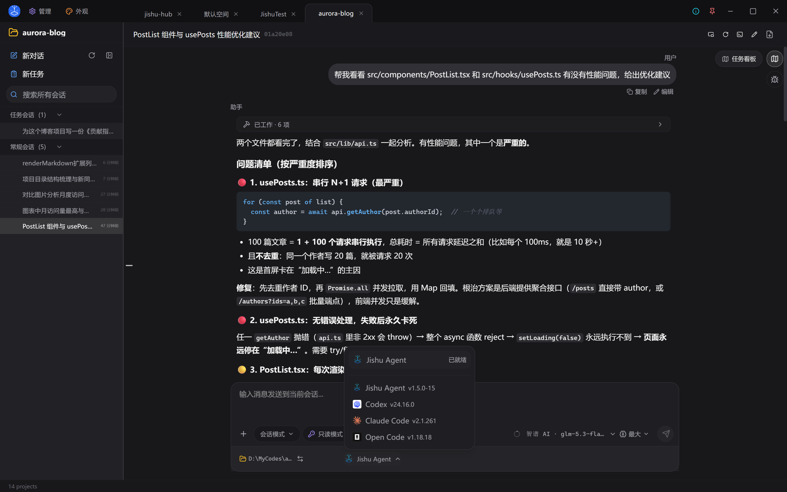
  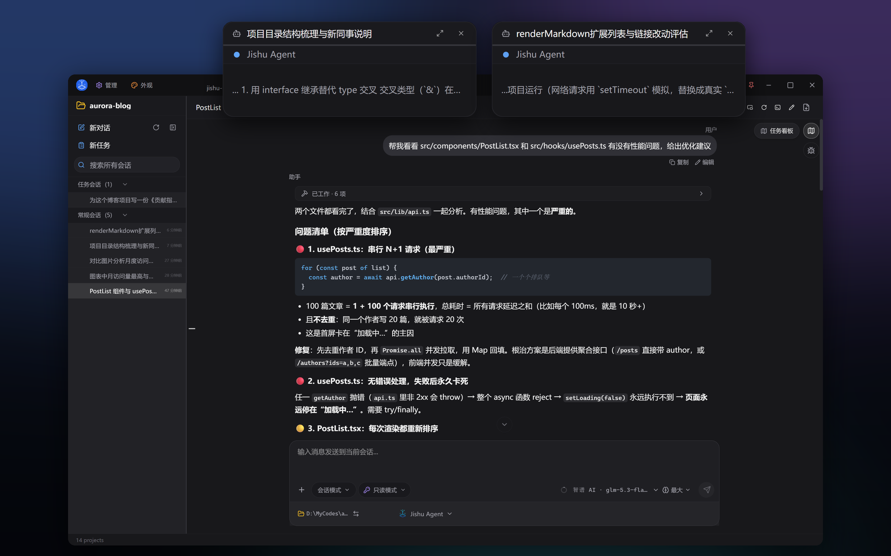
</p>
Switch smoothly between CLI agents (Claude Code, OpenAI Codex, Open Code, and more) via the plugin architecture. Run multiple sessions in parallel across projects without context interference — and pop any session into a floating window to watch its output live.

### Task Mode & Artifacts Center
<p align="center">
  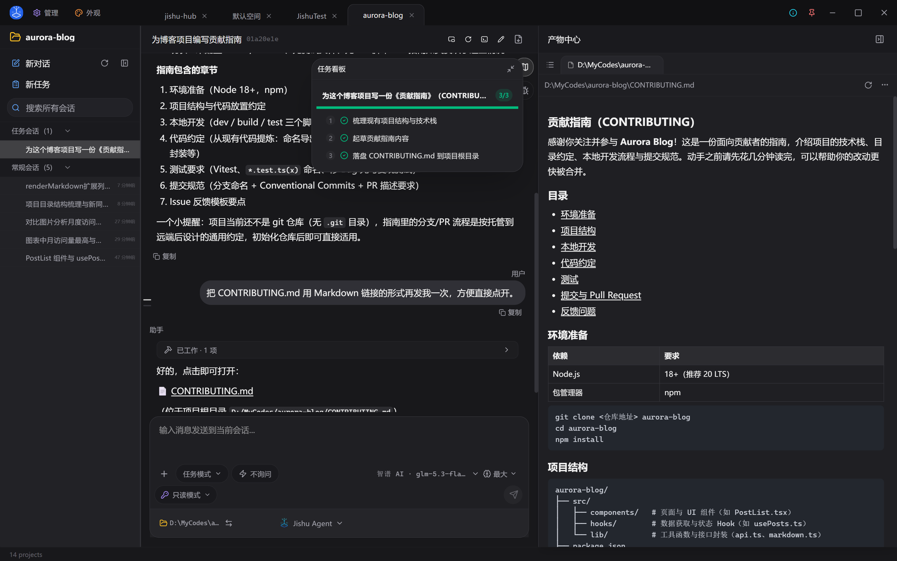
</p>
In task mode the agent breaks the work into steps and drives them forward while the task board tracks progress in real time. Files it produces show up as reference cards in the reply — click one to preview it right in the Artifacts sidebar.

### Plugin Market & Scene Guidance
<p align="center">
  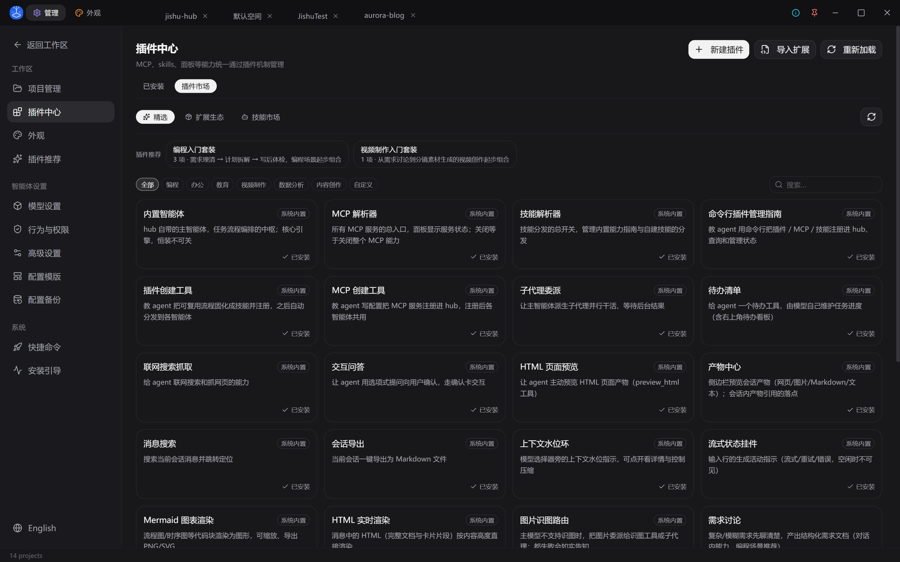
  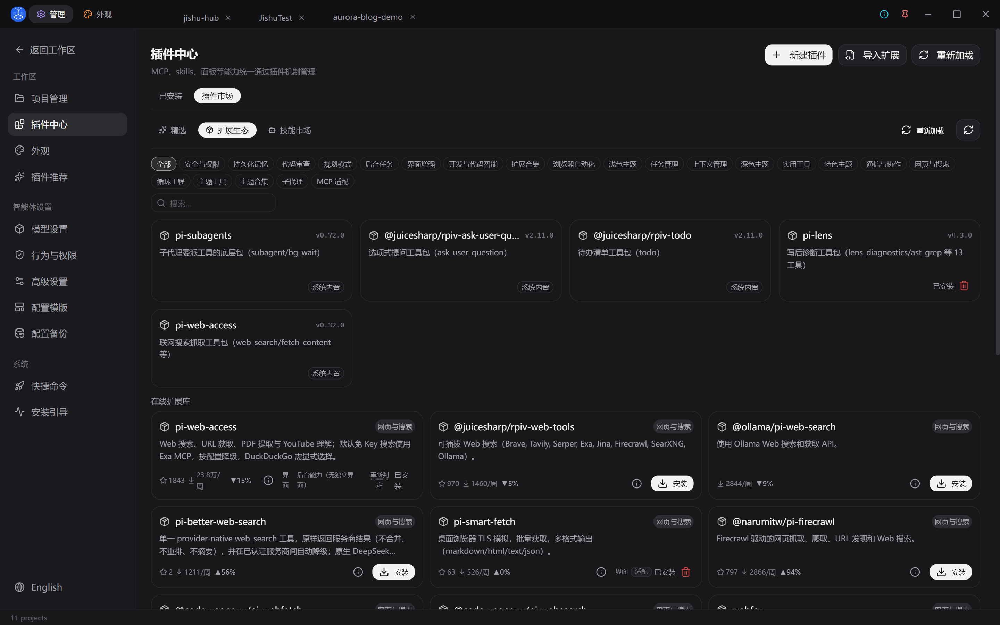
</p>
<p align="center">
  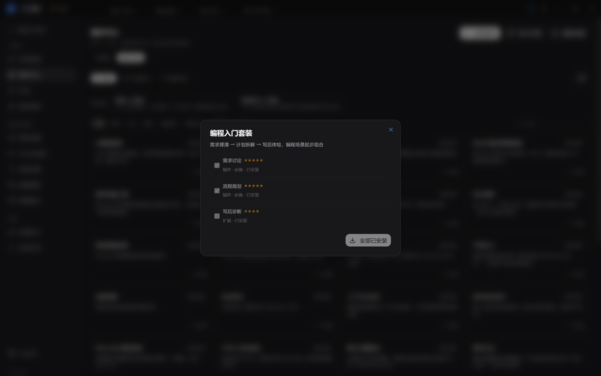
  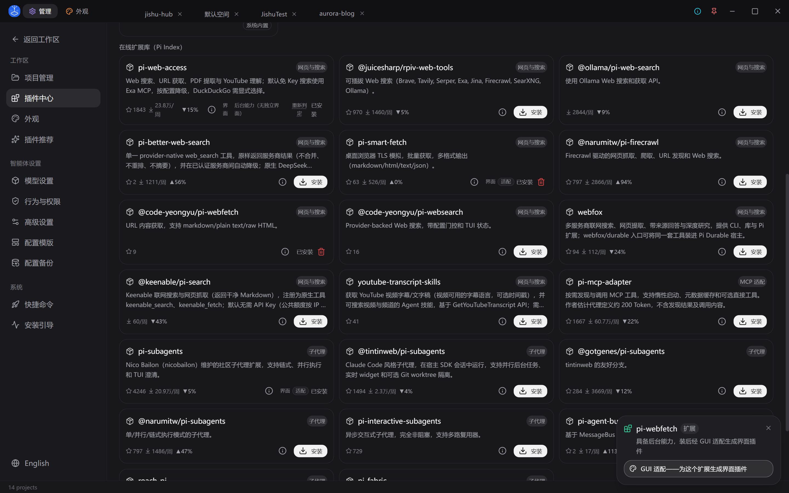
</p>
A three-source plugin market: curated picks, the Pi extension ecosystem, and the skill market. Install a whole scene bundle in one click; a guide card then tells you what you installed, whether it needs configuration, and how to use it first — or generates a UI plugin for an extension in one click.
<p align="center">
  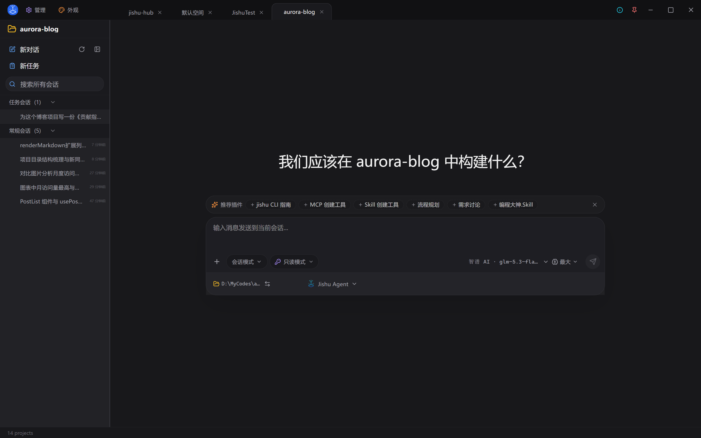
</p>
In a new conversation, suggested plugins for the scene appear right above the input box — click to mount one.

### Project & Session Management
<p align="center">
  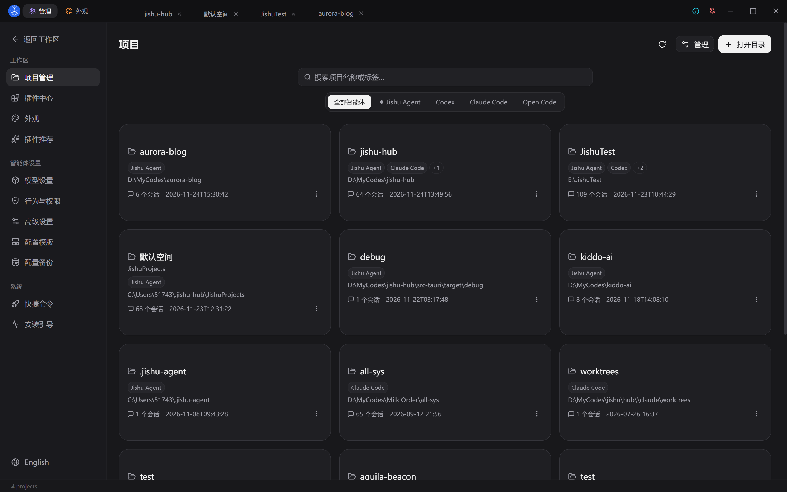
  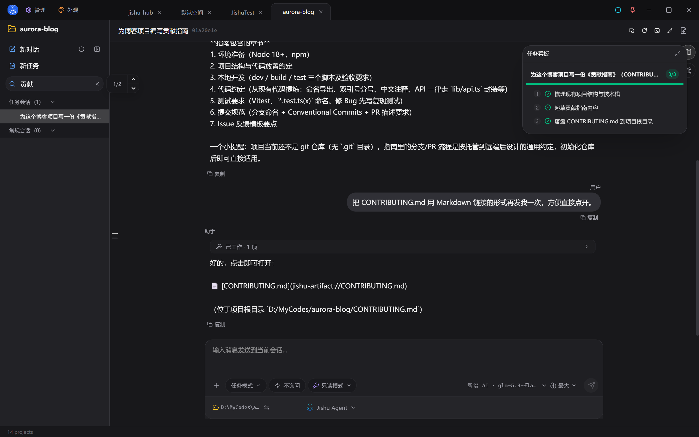
</p>
Projects are automatically discovered and organized. Instantly locate past conversations with the project-wide session search, with every match highlighted in place.

### Configuration
<p align="center">
  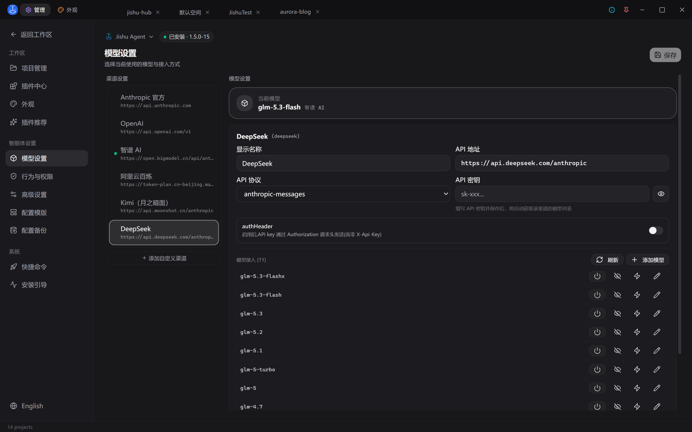
</p>
Ditch manual JSON edits. Manage model channels, access permissions, and behavior templates in visual forms — with built-in channels for popular providers (Zhipu AI, Alibaba Bailian, Kimi, DeepSeek, …), custom channels, and automatic backup & restore.

## Features

### Plugin Market & Scene Guidance (v0.9.8)
- Three-source plugin market: curated picks / Pi extension ecosystem / skill market (SkillHub)
- One-click scene bundles: starter bundles for coding and video production — fine-tune the checklist and install in one go, with more scenes on the way
- Post-install guide card: what you installed, whether config is needed, how to use it first — plus one-click GUI adaptation to generate a UI plugin for an extension
- Empty-session scene suggestions: recommended tools per scene, injected with one click
- Cross-process plugin state sync: change state via CLI, sync in the GUI with one click

### Task Mode & Artifacts Center (v0.9.6+)
- Multi-step task orchestration: task graph, task & result cards, parallel processing
- Artifacts sidebar: session outputs at a glance, type-routed preview, direct artifact references
- Edit & resend: rewrite a past message and resend; unsent messages dismissible
- Agent pre-connect pool: answers from the first keystroke, no cold-start wait

### Multi-Agent Platform
- Plugin-based agent registration and one-click switching
- Currently supports **Claude Code**, **OpenAI Codex**, **Open Code**, **Jishu Self**
- AgentPlugin trait abstraction — ready to onboard the next agent
- Built-in environment detection and one-click agent installation (npm / winget / choco)

### CLI & Orchestration (v0.6.0)
- `jishu` CLI binary with 17 subcommands — agents, chat, plans & tasks, plugins, models, diagnostics, and more
- Orchestrator engine with planner/dispatcher architecture for multi-step task execution
- LLM provider abstraction (OpenAI / Anthropic) with streaming support
- ACP (Agent Communication Protocol) server over stdio JSON-RPC
- Daemon mode for background task orchestration
- Evolution proposals for self-improving workflows

### In-App Chat
- Talk to AI agents directly inside Hub, no terminal required
- Send any file type as attachments (images, documents, code, etc.)
- Project-local files detected automatically — referenced by path, not copied
- Three ways to add files: paste, drag-and-drop, or file picker
- Streaming output with real-time Markdown rendering
- Floating window (picture-in-picture): watch a session's output live while working on another — ideal for parallel tasks
- Context usage ring: see context consumption next to the model selector; click for details or to compact right away

### Session Management
- Browse all sessions grouped by project
- Full-text content search across sessions in the current project — instantly locate any conversation
- Custom session naming for easy identification
- Resume sessions in terminal with one click

### Project Management
- Auto-discovers all projects across agents
- Shows session count and last active time
- Add projects via folder picker (including uninitialized projects)
- Default workspace: start chatting without picking a project — each session gets its own subdirectory, so throwaway tasks never land in your code repos

### Configuration
- Visual forms for agent settings
- Model selection, access permissions, plugin toggles
- Built-in channels for popular providers (Zhipu AI, Alibaba Bailian, Kimi, DeepSeek, …) — paste an API key and go; custom channels supported
- Behavior templates (daily development / deep work / quick Q&A) applied in one click, or save your current config as your own template
- Auto-backup with one-click restore

### Custom Commands
- Create and manage custom slash commands
- Execute commands directly from the UI

### Personalization
- Three themes: Light / Colorful / Dark (dark by default), plus theme plugins
- Independent font size control for UI and chat content (4 presets)
- Bilingual support (Chinese & English), auto-detects system language

## Roadmap

See [ROADMAP.md](./ROADMAP.md) for direction and cadence (Now / Next / Later).

## Join the Beta

- After trying it out, share feedback via [Gitee Issues](https://gitee.com/wangzwa/jishu-hub/issues) / [GitHub Issues](https://github.com/wang5766171/jishu-hub/issues) — feature ideas, UX problems, and compatibility reports are all welcome
- Look for the "Feature Roadmap" and "Feedback" issues (titles prefixed with 📌) for ongoing discussions

## Contributing

Contributions are welcome! Whether it's code, bug reports, or feature suggestions.

1. Fork the repository
2. Create your feature branch (`git checkout -b feature/amazing-feature`)
3. Commit your changes (`git commit -m 'Add amazing feature'`)
4. Push to the branch (`git push origin feature/amazing-feature`)
5. Open a Pull Request

<details>
<summary><strong>Local Development</strong></summary>

### Prerequisites

| Tool | Min Version | Purpose |
|------|-------------|---------|
| [Node.js](https://nodejs.org/) | 22.19+ / 24+ | Frontend build, tests & bundled engine packaging |
| [Rust](https://rustup.rs/) | 1.89+ | Backend compile (the minimum required by the dependencies locked in `Cargo.lock`) |
| [Git](https://git-scm.com/) | Latest | Cloning the repository with its submodules |
| [VS Build Tools 2022](https://visualstudio.microsoft.com/visual-cpp-build-tools/) | Latest | Windows C++ toolchain |

### Build & Run

```bash
git clone --recursive https://github.com/wang5766171/jishu-hub.git   # --recursive: also checks out third_party/pi
cd jishu-hub
npm install

# First run only — the Rust build script refuses to build until these exist:
(cd third_party/pi && npm install && npm run build)   # build the bundled engine (its build output is not committed)
node scripts/pack-pi.mjs                              # produces third_party/pi-runtime.zip
mkdir -p src-tauri/target/release && touch "src-tauri/target/release/jishu-cli-$(rustc -vV | tr -d '\r' | sed -n 's/^host: //p').exe"   # placeholder for the command-line sidecar

npm run tauri dev
```

> The empty `jishu-cli-<target triple>.exe` is a placeholder that lets the build pass (the same trick CI uses). To use the `jishu` command-line features in dev, build the real binary (`cargo build --release --bin jishu-cli --features cli --manifest-path src-tauri/Cargo.toml`) and copy `src-tauri/target/release/jishu-cli.exe` over it. To produce the installer, run `npm run build`: it packages the bundled engine, builds the command-line program and the frontend, and then builds the installer. It does **not** build the engine itself — the first step above (`npm run build` inside `third_party/pi`) has to be done once beforehand.

</details>

<details>
<summary><strong>Tech Stack</strong></summary>

| Layer | Technology |
|-------|-----------|
| Desktop Framework | [Tauri v2](https://v2.tauri.app/) |
| Frontend | [React 19](https://react.dev/) + [TypeScript](https://www.typescriptlang.org/) |
| UI | [shadcn/ui](https://ui.shadcn.com/) + [Tailwind CSS v4](https://tailwindcss.com/) |
| Backend | [Rust](https://www.rust-lang.org/) |
| i18n | [i18next](https://www.i18next.com/) |

</details>

<details>
<summary><strong>Data Locations</strong></summary>

| Path | Description |
|------|-------------|
| `~/.jishu-hub/` | Hub metadata (agents, session names, presets, state) |
| `~/.jishu-agent/agent/models.json` | Model presets for the built-in agent |
| `~/.jishu-hub/runs/` | Orchestrator run traces (JSONL) |
| `~/.claude/` | Claude Code agent data |
| `~/.codex/` | Codex agent data |
| `~/.jishu-agent/` | Jishu Self agent data (sessions, model config, extensions) |

</details>

## License

[MIT](LICENSE) © 2026 wang5766171
