<div align="center">

# Jishu Hub（机枢）

### 基于 CLI 技术的多智能体协同平台

[](https://gitee.com/wangzwa/jishu-hub/releases)
[](https://gitee.com/wangzwa/jishu-hub/releases)
[](https://github.com/wang5766171/jishu-hub/releases/latest)
[](https://tauri.app/)

[English](README.md) | [中文](#)

镜像：[Gitee](https://gitee.com/wangzwa/jishu-hub) | [GitHub](https://github.com/wang5766171/jishu-hub)

</div>

## 为什么选择 Jishu Hub？

AI 编程智能体正在快速演进 —— Claude Code、OpenAI Codex、Open Code 等强大的 CLI 工具不断涌现，但管理它们却很零散：终端窗口到处都是、会话日志深埋文件中、配置需要手动编辑 JSON。

**Jishu Hub（机枢）** 是一个多智能体协同平台，三根支柱撑起同一个工作台：

> - **多智能体统一面** — Claude Code、OpenAI Codex、Open Code 与自研机枢智能体，在同一个桌面界面会话、切换、并行；跨项目多任务互不干扰
> - **本地优先** — 数据全在你手里：会话历史按项目保存在各智能体自己的本地目录（`~/.claude/`、`~/.codex/`、`~/.jishu-agent/`），元数据在本地 `~/.jishu-hub/`，任何数据都不上传；原生 CLI 对接零代理零包装，Tauri v2 + Rust 安装包小、冷启动快
> - **插件可创作** — 三源插件市场（精选 / Pi 扩展生态 / 技能市场）+ 场景套装一键安装 + 装后引导；界面本身也可被插件重塑（挂载位、块渲染器、主题），甚至让 AI 智能体替你写一个适配插件

## 快速开始

前往 [Gitee Releases](https://gitee.com/wangzwa/jishu-hub/releases) 下载最新版本安装包。

也可以从 [GitHub Releases](https://github.com/wang5766171/jishu-hub/releases/latest) 下载。

**系统要求**：Windows 10 及以上

**首次启动**：应用会自动检测智能体引擎与运行环境（Node.js、Git 等），缺失项按引导一键补齐。

<p align="center">
  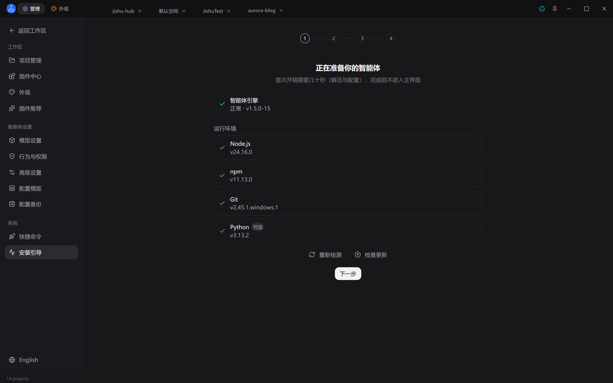
</p>

## 界面预览

### 主对话界面
<p align="center">
  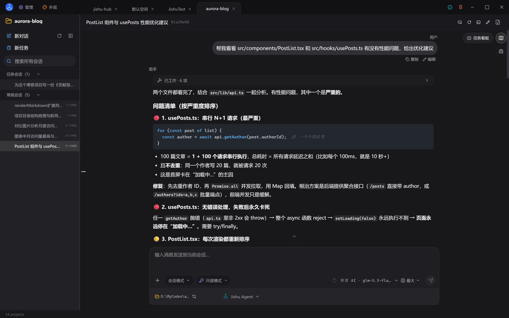
</p>
体验原生桌面上干净、专注且沉浸式的对话界面。Jishu Hub 用精心设计的暗色模式工作区取代了凌乱的终端窗口。

### 多模态交互
<p align="center">
  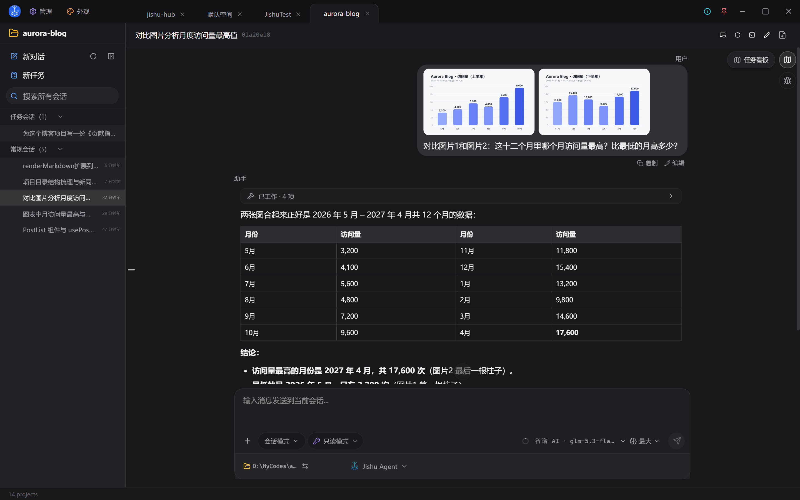
  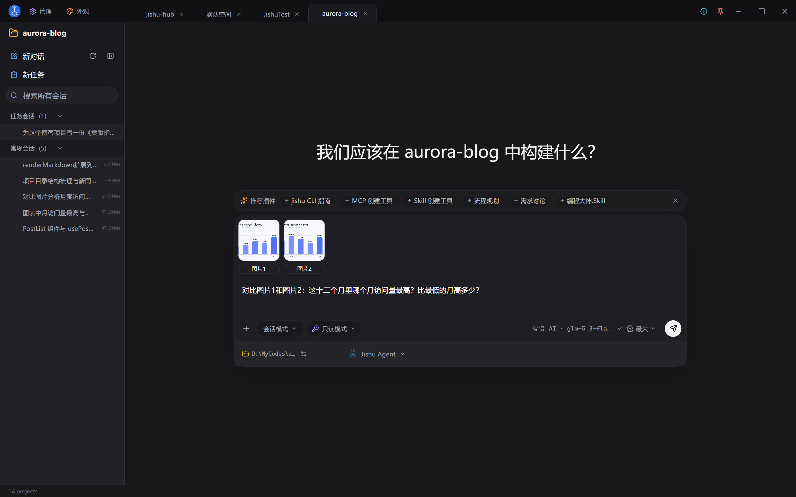
</p>
支持丰富的多模态对话。轻松发送图片和文件；多个附件会自动编号（图片1、图片2…），在消息里直接点名，准确地向 AI 传达你的焦点。

### 多智能体与并行任务处理
<p align="center">
  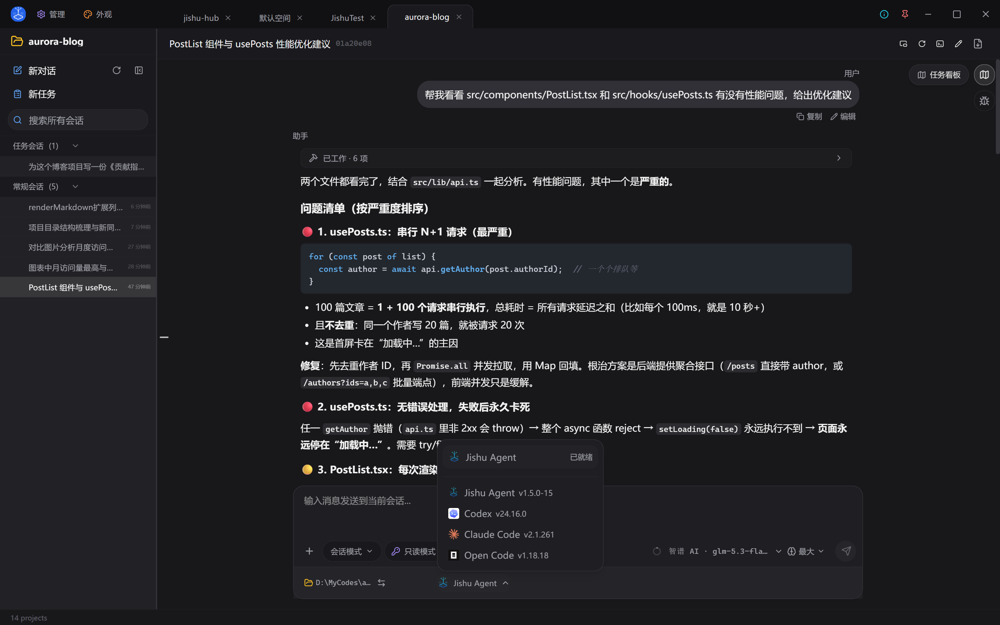
  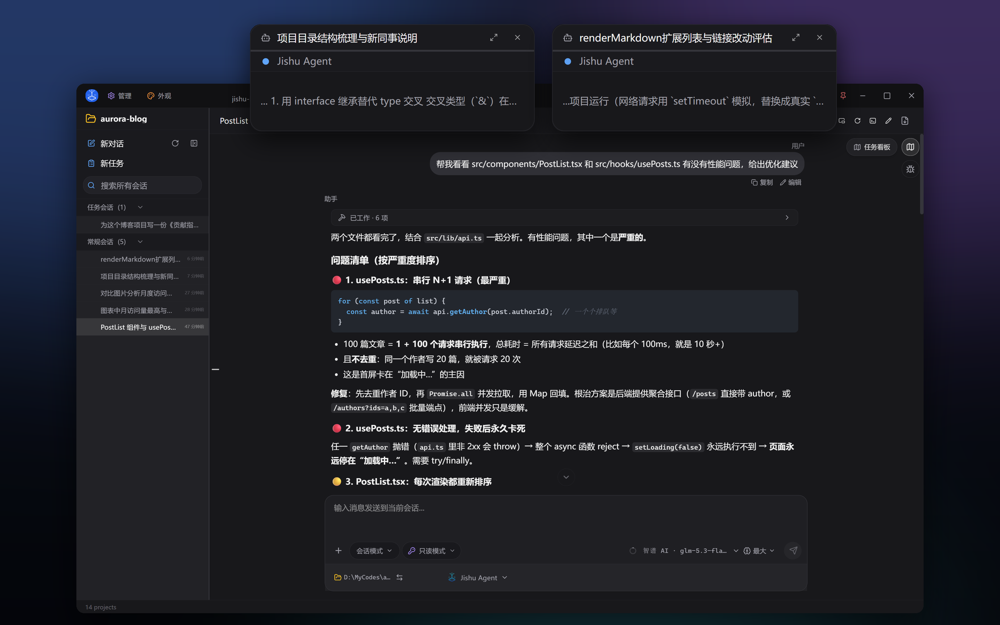
</p>
通过插件架构，在不同的 CLI 智能体（Claude Code、OpenAI Codex、Open Code 等）之间丝滑切换。支持跨项目并行运行多个对话，上下文互不干扰；任意会话都能放进悬浮窗，实时查看输出。

### 任务模式与产物中心
<p align="center">
  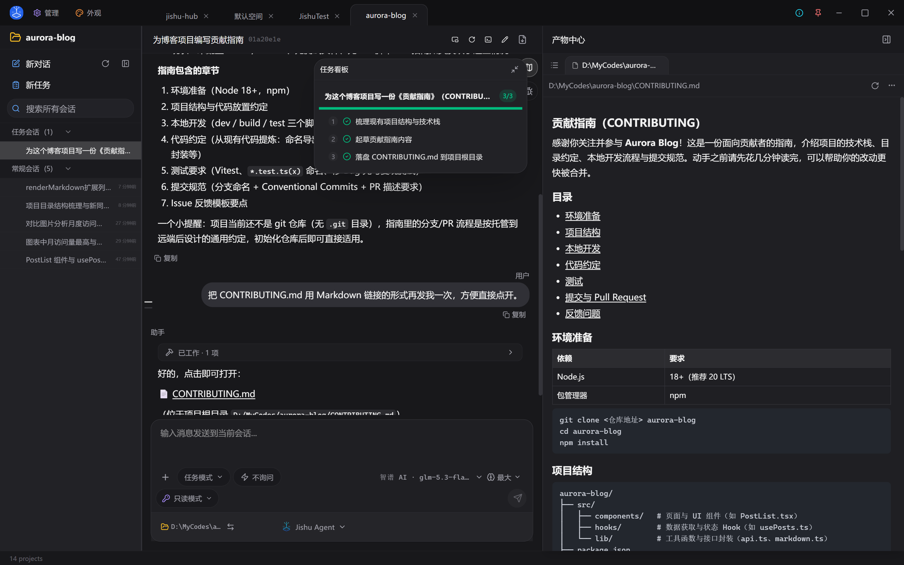
</p>
任务模式下智能体自主拆解步骤、推进执行，任务看板实时显示进度；产出的文件在回复里以引用卡出现，点一下就在右侧产物中心直接预览。

### 插件市场与场景引导
<p align="center">
  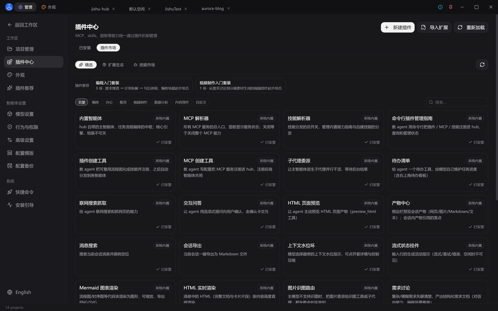
  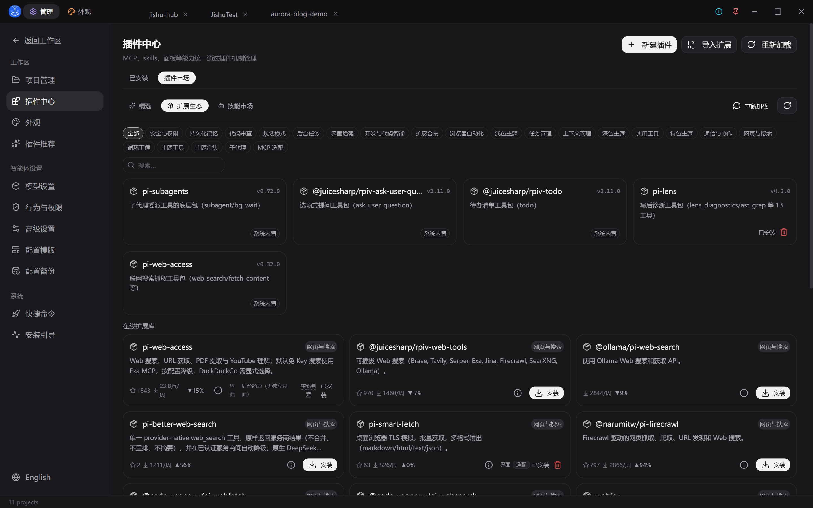
</p>
<p align="center">
  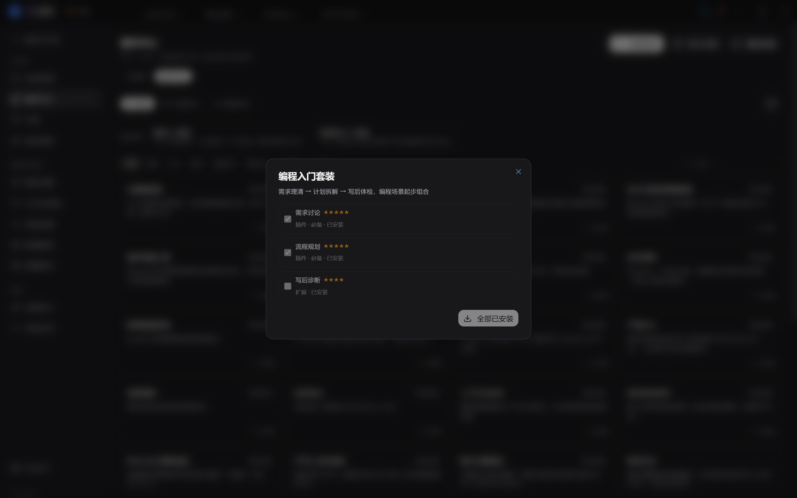
  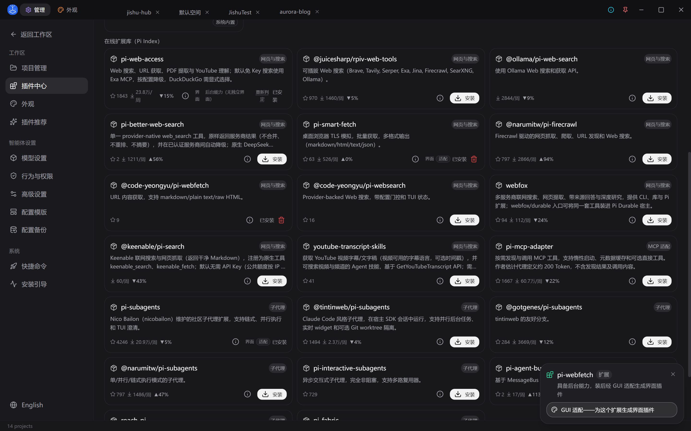
</p>
三源插件市场：官方精选、Pi 扩展生态、技能市场。按场景一键装齐套装；装完即有引导卡说明「装了什么、要不要配置、首次怎么用」，还能一键为扩展生成界面插件。
<p align="center">
  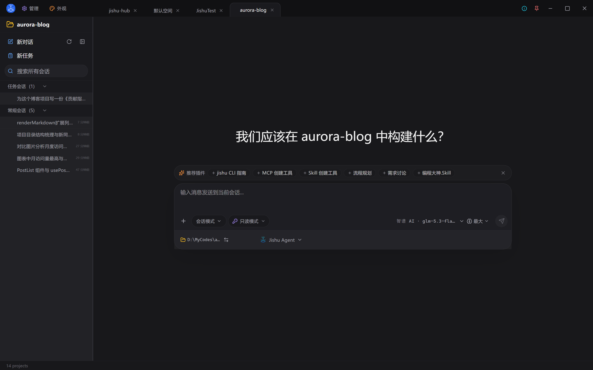
</p>
新对话里，输入框上方按场景给出推荐插件，点一下即可挂载。

### 项目与会话管理
<p align="center">
  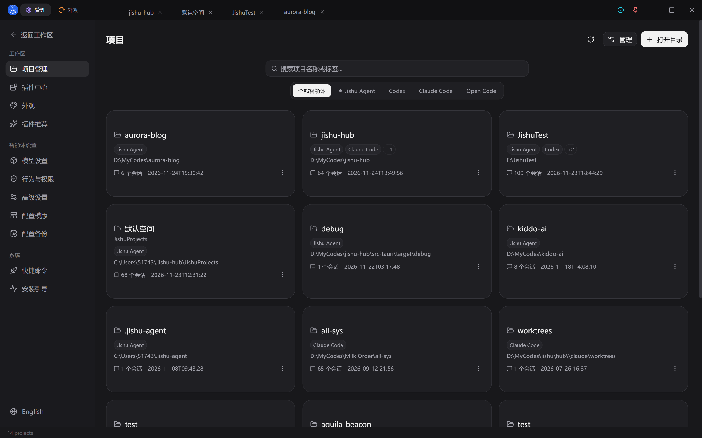
  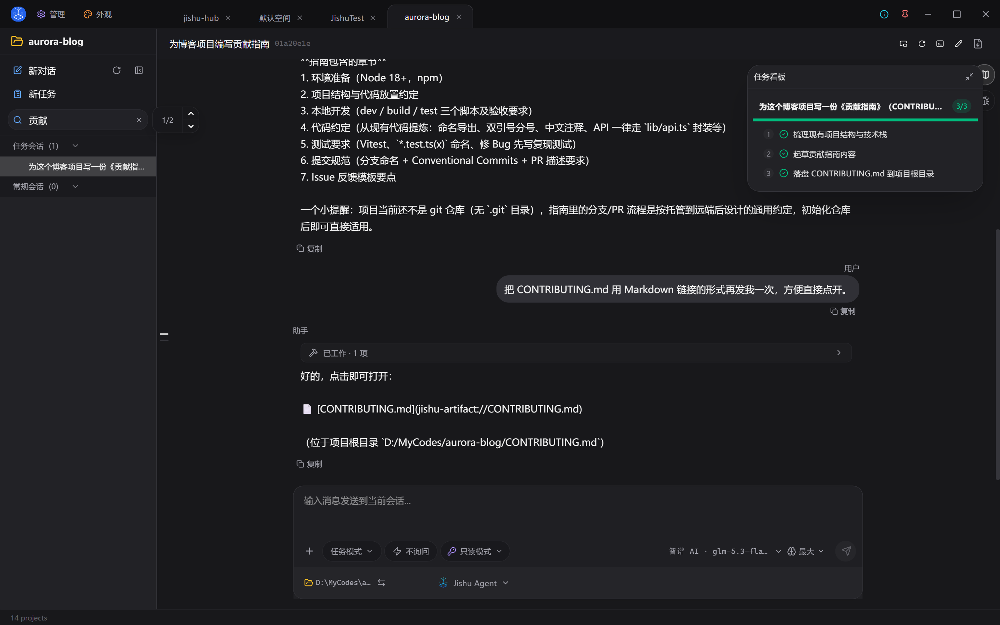
</p>
自动发现和整理你的项目。强大的全局会话搜索，瞬间定位过去的重要对话，命中处高亮显示。

### 配置管理
<p align="center">
  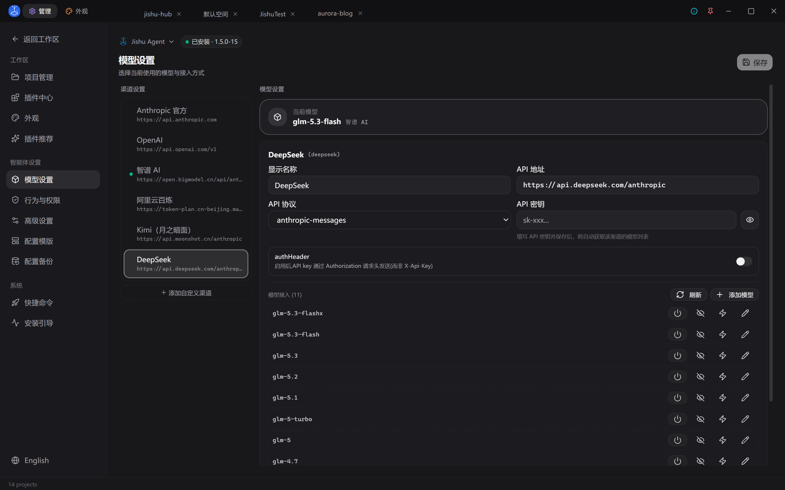
</p>
告别手动修改 JSON 的烦恼。用可视化表单管理模型渠道、访问权限和行为模板；内置智谱 AI、阿里云百炼、Kimi、DeepSeek 等主流供应商渠道，填入 API Key 即可使用，支持自定义渠道、配置备份与恢复。

## 功能特性

### 插件市场与场景引导（v0.9.7+）
- 三源插件市场：官方精选 / Pi 扩展生态（Pi Index） / 技能市场（SkillHub）
- 场景套装一键安装：编程、视频制作两个起步套装，勾选微调一次装齐，更多场景陆续补充
- 装后引导卡：装完即知「装了什么 / 要不要配置 / 首次怎么用」；扩展可一键 GUI 适配生成界面插件
- 空会话场景联动推荐：按场景建议挂载工具，点击即注入
- 插件启停跨进程同步：命令行改状态，界面确认卡一键同步

### 任务模式与产物中心（v0.9.6+）
- 多步骤任务编排：任务图、任务卡与成果卡、并行处理
- 产物中心侧边栏：会话产出一览、类型分流预览、产物引用直达
- 编辑重发：改写历史消息重发，未送达消息可删
- 智能体预连接池：开聊即答，免除冷启动等待

### 多智能体平台
- 插件化智能体注册与一键切换
- 目前支持 **Claude Code**、**OpenAI Codex**、**Open Code**、**机枢自研（Jishu Self）**
- AgentPlugin trait 抽象层，可轻松接入新智能体
- 内置环境检测与智能体一键安装（npm / winget / choco）

### CLI 与任务编排（v0.6.0）
- `jishu` CLI 命令行工具，包含 17 个子命令，覆盖智能体、插件、会话、配置等
- 编排引擎（Orchestrator）采用 planner/dispatcher 架构，支持多步骤任务执行
- LLM 供应商抽象层（OpenAI / Anthropic），支持流式输出
- ACP（智能体通信协议）服务器，通过 stdio JSON-RPC 通信
- 守护进程模式，支持后台任务编排
- 进化提案机制，支持自改进工作流

### 应用内对话
- 无需打开终端，直接在 Hub 内与 AI 智能体对话
- 支持发送任意格式文件附件（图片、文档、代码等）
- 项目内文件自动识别，直接引用路径不重复复制
- 支持粘贴、拖拽、文件选择器三种方式添加附件
- 流式输出 + Markdown 实时渲染
- 悬浮窗（画中画）：会话输出实时悬浮显示，多任务并行时一眼掌握进度
- 上下文水位环：模型选择器旁实时显示上下文占用，点开查看详情或立即压缩

### 会话管理
- 按项目分组浏览所有会话
- 会话内容全文搜索，快速定位历史对话
- 自定义会话名称，方便管理
- 会话可一键在终端中继续

### 项目管理
- 自动发现所有智能体下的项目
- 显示会话数、最后活跃时间
- 通过文件夹选择器添加项目（含未初始化项目）
- 默认工作空间：不选项目也能开聊，每个会话使用独立子目录，临时任务不混入代码仓库

### 配置管理
- 可视化表单管理智能体配置
- 模型选择、访问权限、插件开关
- 内置智谱 AI、阿里云百炼、Kimi、DeepSeek 等主流供应商渠道，填入 API Key 即可使用；支持自定义渠道
- 行为模板（日常开发 / 深度攻坚 / 快速问答）一键应用，也可把当前配置保存为自己的模板
- 自动备份 + 一键恢复历史版本

### 自定义命令
- 创建和管理自定义斜杠命令
- 直接在界面中执行

### 个性化
- 三种主题：浅色 / 色彩 / 暗色（默认暗色），支持自定义配色方案
- 系统界面和会话内容字体独立调节（四档预设）
- 中英文双语支持，自动识别系统语言

## Roadmap

版本方向与节奏见 [ROADMAP.md](./ROADMAP.md)（Now / Next / Later 摘录）。

## 参与体验

- 下载试用后欢迎到 [Gitee Issues](https://gitee.com/wangzwa/jishu-hub/issues) / [GitHub Issues](https://github.com/wang5766171/jishu-hub/issues) 反馈：功能建议、体验问题、兼容性报告都欢迎
- 仓库内置「功能路线图」「体验反馈」两个置顶 issue，可直达当前讨论

## 贡献

欢迎贡献代码、报告问题或提出建议！

1. Fork 本仓库
2. 创建特性分支 (`git checkout -b feature/amazing-feature`)
3. 提交更改 (`git commit -m 'Add amazing feature'`)
4. 推送到分支 (`git push origin feature/amazing-feature`)
5. 发起 Pull Request

<details>
<summary><strong>本地开发</strong></summary>

### 环境要求

| 软件 | 最低版本 | 用途 |
|------|----------|------|
| [Node.js](https://nodejs.org/) | 18+ | 前端构建 |
| [Rust](https://rustup.rs/) | 1.79+ | 后端编译 |
| [VS Build Tools 2022](https://visualstudio.microsoft.com/visual-cpp-build-tools/) | 最新 | Windows C++ 工具链 |

### 构建运行

```bash
git clone https://github.com/wang5766171/jishu-hub.git
cd jishu-hub
npm install
npm run tauri dev
```

</details>

<details>
<summary><strong>技术架构</strong></summary>

| 层 | 技术 |
|----|------|
| 桌面框架 | [Tauri v2](https://v2.tauri.app/) |
| 前端 | [React 19](https://react.dev/) + [TypeScript](https://www.typescriptlang.org/) |
| UI | [shadcn/ui](https://ui.shadcn.com/) + [Tailwind CSS v4](https://tailwindcss.com/) |
| 后端 | [Rust](https://www.rust-lang.org/) |
| 国际化 | [i18next](https://www.i18next.com/) |

</details>

<details>
<summary><strong>数据存储</strong></summary>

| 路径 | 说明 |
|------|------|
| `~/.jishu-hub/` | Hub 元数据（智能体注册、会话名称、预设、状态、模型配置） |
| `~/.jishu-hub/models.json` | LLM 模型预设配置 |
| `~/.jishu-hub/runs/` | 编排引擎运行追踪（JSONL） |
| `~/.claude/` | Claude Code 智能体数据 |
| `~/.codex/` | Codex 智能体数据 |
| `~/.jishu-agent/` | 机枢自研智能体数据（会话、模型配置、扩展） |

</details>

## License

[MIT](LICENSE) © 2025 Jishu Hub
